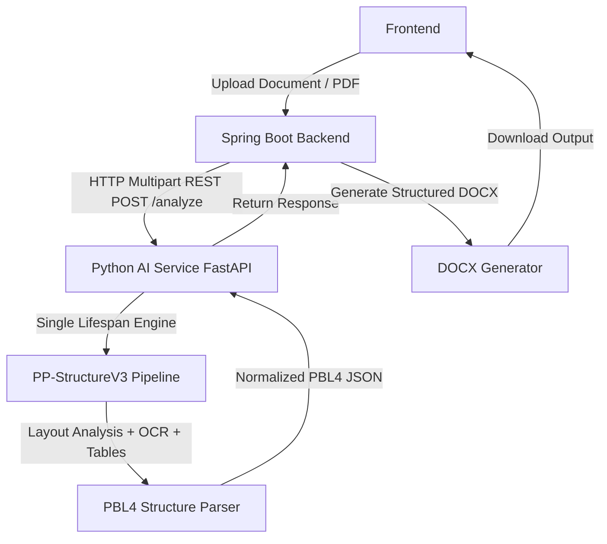

# Doc Force AI Server — PBL4 Document AI Service

**Doc Force AI Server** is a modular Python FastAPI AI Service responsible for document layout analysis, text OCR, table structure recognition, and document element parsing using **PaddleOCR PP-StructureV3**.

It serves as the AI engine in the PBL4 architecture:
**"Hệ thống Scan và Ứng dụng AI trong Xử lý, Phục hồi & Đa dạng hóa Định dạng Tài liệu Số"**

---

## Architecture



---

## Technical Stack & Requirements

- **Python**: 3.11 (Recommended Python 3.11.9)
- **Framework**: FastAPI 0.110+, Uvicorn 0.28+
- **AI Models**: PaddlePaddle 3.0+, PaddleOCR 3.7+, PaddleX 3.7+ (`PP-StructureV3` pipeline)
- **PDF Processing**: `pypdfium2`
- **CV & Data**: OpenCV 4.8+, Pillow 10.0+, NumPy 1.24+, Pydantic V2

---

## Project Structure

```text
doc-force-ai-server/
├── app/
│   ├── main.py                     # FastAPI entry point & lifespan engine initialization
│   ├── api/
│   │   ├── router.py               # API route aggregator
│   │   └── endpoints/
│   │       ├── structure.py        # /health and /analyze endpoints for PP-StructureV3
│   │       ├── health.py           # Legacy health route
│   │       ├── scan.py             # Image quality & scan pipeline
│   │       ├── analyze.py          # Quality analyze endpoint
│   │       ├── ocr.py              # Pytesseract OCR endpoint
│   │       ├── process.py          # Image perspective transform endpoint
│   │       └── defects.py          # Defect detection endpoint
│   ├── core/
│   │   ├── config.py               # Pydantic BaseSettings & AI model configs
│   │   ├── exceptions.py           # Structured error handling
│   │   └── logging.py              # Logging configuration
│   ├── services/
│   │   ├── structure_engine.py     # PP-StructureV3 singleton engine manager
│   │   ├── structure_parser.py     # PBL4 JSON normalization parser
│   │   └── ...                     # Scan, image, quality, and defect services
│   ├── schemas/
│   │   ├── structure.py            # Pydantic V2 models for PBL4 JSON format
│   │   └── ...                     # Legacy scan schemas
│   └── cv/                         # OpenCV detectors (blur, skew, brightness, etc.)
├── models/
│   └── README.md                   # Future fine-tuned model checkpoint directory
├── datasets/
│   └── README.md                   # Annotation & dataset collection guidelines
├── training/
│   └── README.md                   # Fine-tuning & evaluation instructions
├── data/
│   ├── input/                      # Uploaded files
│   └── output/
│       ├── raw/                    # Saved raw PP-StructureV3 output dicts
│       └── parsed/                 # Saved PBL4 standardized JSON output
├── tests/
│   ├── test_analyze.py             # Integration tests for /health & /analyze
│   ├── test_structure_parser.py    # Unit tests for normalization parser
│   └── ...                         # Scan & quality tests
├── requirements.txt
├── start-ai-service.bat            # One-click Windows startup script
├── run.py                          # Development launcher
└── README.md
```

---

## Installation (Windows PowerShell)

1. Create a virtual environment using Python 3.11:

```powershell
python -m venv .venv311
.\.venv311\Scripts\Activate.ps1
```

2. Install dependencies:

```powershell
pip install -r requirements.txt
```

---

## Running the AI Service

### Option A: PowerShell / Terminal

```powershell
.\.venv311\Scripts\python.exe run.py
```

### Option B: Direct Uvicorn

```powershell
.\.venv311\Scripts\uvicorn.exe app.main:app --host 0.0.0.0 --port 8000 --reload
```

### Option C: Windows Batch File

Double-click `start-ai-service.bat` or run:

```cmd
start-ai-service.bat
```

Swagger UI documentation will be available at: `http://localhost:8000/docs`

---

## API Endpoints

### 1. GET `/health`

Health check endpoint returning service status and model information.

**Sample Request**:
```http
GET /health HTTP/1.1
Host: localhost:8000
```

**Sample Response**:
```json
{
  "status": "ok",
  "service": "pbl4-ai-service",
  "model": "PP-StructureV3"
}
```

---

### 2. POST `/analyze`

Analyzes a document image (`.png`, `.jpg`, `.jpeg`, `.webp`, `.bmp`, `.tiff`) or `.pdf` file using PP-StructureV3 and returns normalized PBL4 JSON.

**Sample Request (cURL)**:
```powershell
curl -X POST "http://localhost:8000/analyze" -F "file=@C:\path\to\document.jpg"
```

**Sample Response (PBL4 Standardized JSON)**:
```json
{
  "success": true,
  "file_id": "a1b2c3d4e5f6",
  "filename": "document.jpg",
  "pages": [
    {
      "page_number": 1,
      "width": 1920,
      "height": 1080,
      "elements": [
        {
          "id": "element-1",
          "type": "title",
          "raw_type": "doc_title",
          "text": "BÁO CÁO KẾT QUẢ PBN4",
          "bbox": [100.0, 50.0, 800.0, 150.0],
          "confidence": 0.98,
          "html": null
        },
        {
          "id": "element-2",
          "type": "text",
          "raw_type": "normal_text",
          "text": "Nội dung phân tích tài liệu và nhận dạng chữ tự động.",
          "bbox": [100.0, 180.0, 1600.0, 300.0],
          "confidence": 0.95,
          "html": null
        },
        {
          "id": "element-3",
          "type": "table",
          "raw_type": "table",
          "text": "",
          "bbox": [100.0, 350.0, 1700.0, 800.0],
          "confidence": 0.91,
          "html": "<table><tr><td>Header 1</td><td>Header 2</td></tr></table>"
        }
      ]
    }
  ],
  "document": {
    "file_id": "a1b2c3d4e5f6",
    "filename": "document.jpg",
    "pages": [...]
  },
  "processing_time_ms": 1245.5,
  "model": "PP-StructureV3"
}
```

---

## Spring Boot Backend Integration Example

In your Spring Boot project (`DocumentAiService.java`), configure HTTP call to the AI Service:

```java
@Service
public class DocumentAiService {

    @Value("${ai.service.url:http://localhost:8000}")
    private String aiServiceUrl;

    private final RestTemplate restTemplate = new RestTemplate();

    public Pbl4DocumentResponse analyzeDocument(MultipartFile file) throws IOException {
        HttpHeaders headers = new HttpHeaders();
        headers.setContentType(MediaType.MULTIPART_FORM_DATA);

        MultiValueMap<String, Object> body = new LinkedMultiValueMap<>();
        body.add("file", new ByteArrayResource(file.getBytes()) {
            @Override
            public String getFilename() {
                return file.getOriginalFilename();
            }
        });

        HttpEntity<MultiValueMap<String, Object>> requestEntity = new HttpEntity<>(body, headers);

        String url = aiServiceUrl + "/analyze";
        ResponseEntity<Pbl4DocumentResponse> response = restTemplate.postForEntity(
                url,
                requestEntity,
                Pbl4DocumentResponse.class
        );

        return response.getBody();
    }
}
```

---

## Running Tests

Execute pytest suite:

```powershell
.\.venv311\Scripts\pytest.exe -v
```

---

## Future Fine-Tuning & Model Replacement Phase

The codebase is organized to support replacing pretrained PP-StructureV3 with a custom fine-tuned PBL4 model in Phase 4:

```text
Pretrained Model Pipeline
        ↓
Collect & Annotate PBL4 Document Dataset (datasets/)
        ↓
Fine-Tune PP-DocLayout & Table Models (training/)
        ↓
Place Fine-Tuned Checkpoints (models/)
        ↓
Configure Model Directory in .env
```
